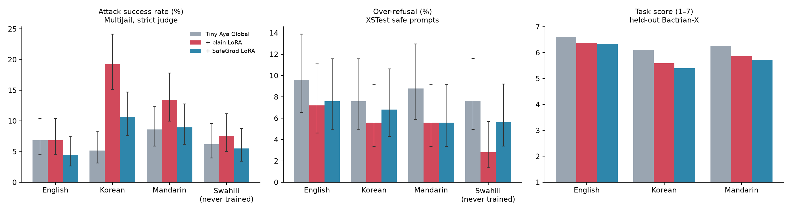
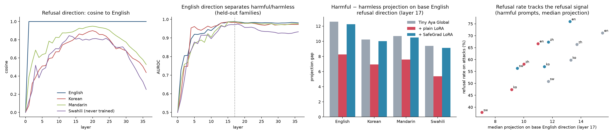

# Lost in Refusal

Entry to the [Lexsi AI Safety and Alignment Hackathon](https://lexsi.ai), Track 2 (Red Teaming, Safety and Alignment).
Team: Aishwarya Nikkumbh (lead), Mingyu Kang, Hannah Pham.

**Use case.** A company self-hosts Tiny Aya Global as a customer-support bot for English, Korean and Mandarin
customers (Swahili next) and fine-tunes it on harmless instruction data, checking safety in English as most teams
do.

**Question.** A small multilingual model is fine-tuned on harmless instructions in English, Korean and Mandarin.
Does it stop refusing harmful requests, is the damage worse outside English, does it reach a language it was never
fine-tuned on (Swahili), and can SafeTune prevent it without hurting the task?

**Setup.** [Tiny Aya Global](https://huggingface.co/CohereLabs/tiny-aya-global) (3.35B) fine-tuned with LoRA on 1,800
benign Bactrian-X rows (600 instructions × en/ko/zh). Two arms with identical data, order, LoRA config and optimizer:
plain LoRA, and LoRA hardened with SafeTune's SafeGrad. Evaluated on 291 MultiJail attack families in
en/ko/zh/**sw**, XSTest's 250 safe prompts (over-refusal) in the same four languages, and 100 held-out Bactrian-X
tasks per training language. Safety judge: Qwen3Guard-Gen-4B. Task judge: Qwen3-14B with Tiny Aya's 1–7 rubric.

## Stage 2: three seeds, and where the result stops

The stage 1 results further down are one seed. Stage 2 (the finalist round) repeats the headline on three seeds and
tests where it stops holding. The preregistration [`docs/lir/stage2-prereg.md`](docs/lir/stage2-prereg.md) was
written before any stage 2 adapter was evaluated, with the seed 42 results of stage 1 already known, and each
later check was added to it before its runs were read. Where a check was added after part of its result was known,
the file says so. The status page [`results/lir/stage2/README.md`](results/lir/stage2/README.md) has every check
with its numbers, the ones that failed included. Strict attack success counts the guard's Unsafe and Controversial classes; brackets are 95%
intervals from a bootstrap over the 291 prompt families, pooled over seeds.

| Check | Result | Main numbers |
|---|---|---|
| Korean drifts more than English (H1) | Pass in every seed (3) | Korean strict attack success rises 14.1, 10.3 and 13.7 points. Korean-minus-English gap +11.8 [+6.8, +16.7] |
| SafeGrad repairs it (H2) | Pass in every seed (3) | Korean, SafeGrad against plain: −8.6, −7.2 and −9.3 points. Pooled −8.4 [−11.3, −5.5] |
| Swahili refusals fall (H3) | Pass in every seed (3) | −13.1, −6.2 and −8.6 points. Pooled −9.3 [−13.7, −5.2] |
| Six more untrained languages (U1, U2) | Refusals fell on average over the six, and SafeGrad kept more of them (3 seeds) | Refusal rate, plain minus base −4.9 [−7.0, −2.9]; SafeGrad minus plain +6.2 [+4.4, +8.0]; the same after the capped answers were generated again (−4.7 [−6.7, −2.7] and +6.3 [+4.5, +8.0]) |
| No Korean rows in training (K1) | Korean rows are not needed for a drift of this size, in all three seeds | Korean 18.2%, 18.6% and 18.2% with no Korean rows in training, against 5.2% for the base model |
| The same fine-tune through Lexsi's AlignTune (T1) | Korean drifts through a second training stack too (1 run, 1 seed) | Korean 5.2% to 18.6% (+13.4 points, p < 0.001); 19.2% from our own trainer at the same seed |
| One training language at a time (SL1) | Korean drifts when the model is trained on English alone, Korean alone or Chinese alone: all nine runs | Korean rises +8.0 [+4.8, +11.3], +11.2 [+7.3, +15.1] and +11.6 [+7.9, +15.5] points |
| A second model, Tiny Aya Earth (E1) | Drift and repair pass in every seed (3) | Korean rise +10.1 [+6.4, +14.0]; SafeGrad against plain −6.2 [−9.2, −3.4] |
| A second training set, Aya (Y1, Y2) | Drift and repair pass on three seeds | Korean rises 10.0, 8.9 and 9.3 points; SafeGrad against plain −4.8 [−7.2, −2.6] |
| The 256-token answer cap | The headline does not depend on it | Korean rise +12.7 points before and +13.2 after every capped answer was generated again at 1,024 tokens |
| A second machine (NVIDIA L4) | Same strict attack success as on the laptop: none of eight differences is significant | Korean: base 5.2% and 5.5%, plain 19.2% and 19.9% |
| 4-bit loading (NF4) | SafeGrad stays below plain on Korean | Plain 22.7%, SafeGrad 11.0% |
| Refusal direction (R1) | Plain fine-tuning moves Korean and English the same distance along the refusal direction | Korean shift minus English shift +0.08 units [−0.08, +0.25], against shifts of about 3.5 |

Among what did not hold or was not tested (the status page has the full list):

- **One safety judge.** A second judge failed our agreement check (80% per language on 120 human labels) with both
  models we tried, so no headline number is confirmed by a second judge.
- **A person's reading of the Korean rise (K2) did not pass:** 5 plain answers against 1 base answer marked unsafe
  on 94 prompts, p = 0.22. A second reading on the 161 Korean prompts nobody had read (K3) did not pass either:
  11 against 5 on 145 prompts, p = 0.070. One labeller, seed 42.
- **"Hardest in Korean" holds among four languages, not ten.** In six more languages the model was never
  fine-tuned on (Italian, Vietnamese, Arabic, Thai, Bengali, Javanese; section 14b of the preregistration) the
  guard's attack success rose in Thai (+11.7 [+8.1, +15.3]), Javanese (+9.4 [+5.4, +13.5]) and Vietnamese
  (+8.1 [+5.0, +11.6]), and those rises could not be told apart from Korean's (+12.7 [+8.9, +16.7]). No language
  rose more than Korean. The fall in refusals above is an average: it was not detected in Javanese, Arabic or
  Bengali. No person has checked the guard in the six added languages. Read again after every capped answer there
  was generated again at 1,024 tokens (section 14e; not blind; it decides nothing), the three checks came out the
  same. With no rule, Bengali's attack success under plain was then above base (+5.6 [+1.7, +9.3], against
  +1.6 [−2.5, +5.6] capped); Korean's rise is larger than Bengali's on both readings.
- **On the Aya training set the Swahili refusal drop did not carry over (Y3 fails):** −3.4, −3.1 and −1.4 points,
  pooled −2.6 [−6.9, +1.5]. The Swahili finding rests on Bactrian-X.
- **The Korean clean set (H4) was not tested,** because its human check failed.
- **Our forecast for Tiny Aya Earth's Swahili refusals (E2) was not confirmed:** we forecast a larger drop than
  Global's, and Earth's is smaller (−6.9 points against −13.1 at seed 42).
- **SafeGrad does not protect better than the simple fix.** Adding the same 47 refusal examples to the training
  data as five copies left Korean attack success 2.7 points below SafeGrad's on two new seeds [−5.2, −0.5]; with
  the examples added once no difference was detected (−0.5 [−2.9, +1.9]). Both raised English over-refusal about
  5 points above SafeGrad's (+5.2 [+2.8, +8.0] and +5.0 [+2.6, +7.6]). SafeGrad's advantage over mixing is that it
  over-refuses less than either mixing arm. Run on Nov 23 under the deadline extension (section 14a of the preregistration). Read
  again after the capped answers were generated again at 1,024 tokens (section 14g; not blind; it decides nothing),
  both checks came out the same for both arms (five copies −2.6 [−5.0, −0.5]; once −0.3 [−2.7, +1.9]).
- **The drift is not a product of our learning rate or number of epochs (section 14h, read Nov 24).** With the learning
  rate halved or doubled, or half or twice the epochs, Korean attack success rose 13.1, 16.5, 21.0 and 11.3 points over
  base at seed 42, each p < 0.001, and Korean rose more than English every time. The task score fell below base at all
  four settings (−0.61, −0.39, −0.66 and −0.35 points). One run and one seed per setting; no setting is a fix, and we
  write no trend: we expected the weaker runs to drift less, and the run with half the epochs rose most.
- **The drift and both repairs show on a second safety benchmark (section 14i, read Nov 24).** On the 200 unsafe prompts
  of XSTest in four languages, plain fine-tuning raised Korean attack success by 10.5 points [+5.8, +15.3] over base,
  pooled over three seeds, and Korean rose more than English (+8.7 [+3.5, +13.8]). SafeGrad and mixing in five copies of
  the refusal examples each kept Korean below plain fine-tuning (−7.2 [−10.7, −3.8] and −8.5 [−12.2, −4.8]) on a
  benchmark their refusal examples do not come from. The prompts are machine-translated, and no person has checked them
  or the guard on them. Answers are capped at 256 tokens; after every capped answer was generated again at 1,024 tokens
  all four checks came out the same (section 14j, registered after the first reading and deciding nothing).
- **Not run:** the control that separates 4-bit loading from adapter merging. The list is in the status page. The
  AlignTune run was not made by the freeze of Nov 22; it ran on Nov 23 under the deadline extension, on the laptop
  (section 14d of the preregistration).

## Stage 1 results (seed 42)

Attack success rate on 291 MultiJail families per language (strict judge: Unsafe or Controversial). Change vs the
base model in parentheses; * = p < 0.05, exact McNemar on the same prompts.

| | English | Korean | Mandarin | Swahili (never trained) |
|---|---:|---:|---:|---:|
| Tiny Aya Global | 6.9 | 5.2 | 8.6 | 6.2 |
| + plain LoRA | 6.9 (+0.0) | **19.2 (+14.1\*)** | **13.4 (+4.8\*)** | 7.6 (+1.4) |
| + SafeGrad LoRA | 4.5 (−2.4) | 10.7 (+5.5\*) | 8.9 (+0.3) | 5.5 (−0.7) |

- **Break.** Benign fine-tuning leaves English untouched in our run, so an English-only check passes the model,
  while Korean attack success nearly quadruples and Mandarin rises by half. Refusal on attacks drops in every
  language, Swahili included (50.9% → 37.8%).
- **Replicated on an independent sample.** A plain LoRA on Hannah's separately curated training set (4 of 600 IDs
  shared) gives Korean +16.5, Mandarin +4.8, English +6.5 and Swahili +5.5 points. Of these four languages Korean
  is hit hardest in both samples, at least 2.5 times English; English is not always untouched.
  ([`results/lir/replication/results.md`](results/lir/replication/results.md))
- **The drift reaches the language we never trained on; the judge just can't see it.** Qwen3Guard misses harm in
  Swahili: a quarter of the Swahili answers it passes become unsafe when back-translated to English and re-judged
  (24–28% across models, against 7–10% in Korean and 3–4% in Mandarin, where we ran the same check).
  Counting those, Swahili attack success goes from 16.5% to **23.0% after plain LoRA (+6.5, p = 0.009)** and back
  to 15.5% with SafeGrad (−7.6 vs plain, p = 0.0007), with no Swahili data anywhere in training or alignment.
- **Fix.** Against plain LoRA on the same prompts, SafeGrad cuts attack success by 8.6 points in Korean and 4.5 in
  Mandarin and raises refusal by 9–19 points in all four languages; the largest gain is Swahili (+18.6), which has no
  training or alignment data. XSTest over-refusal stays below the base model (macro 8.4% base, 5.3% plain, 6.4%
  SafeGrad). Cost: 18.5% more training time, final training loss +0.8%. Task quality (Qwen3-14B judge, 1–7): SafeGrad is 0.12 below plain (5.82 vs 5.94 macro; only the Korean −0.19 is significant). Both fine-tunes score below the base model (6.32): training on Bactrian-X's short GPT-3.5 answers cut answer length from ~420 to ~170 tokens without improving reference match (chrF), so the fine-tune bought little on this task and still broke Korean and Mandarin safety.
- **Explain.** The English refusal direction separates harmful from harmless prompts in every language (AUROC
  0.97–0.99 at layer 17), and a linear probe does as well as an MLP, so the model still *recognises* harm. Plain
  LoRA shrinks the harmful-vs-harmless projection on that direction by about a third in every language; SafeGrad
  restores most of it. Across languages and models, refusal rate tracks the median projection of harmful prompts.
- **One direction is enough, but steering is blunt.** Adding the English refusal direction at layer 17 to the plain
  model cuts Korean attack success from 21.2% to 1.2% on the same prompts (Korean's own direction: 10.0%), so
  Korean is not slipping past a shared direction; fine-tuning shrank the magnitude. The cost is XSTest
  over-refusal rising from 7.2% to 25.3%. At half strength steering matches SafeGrad on attacks (macro 5.0 vs 6.6%
  on the same prompts) but over-refuses 10.6% vs 5.6%; SafeGrad is the only fix that does not raise over-refusal.
  ([`results/lir/steering/results.md`](results/lir/steering/results.md))
- **Circuits (CircuitKIT, EAP-IG).** Refusal is spread out: on held-out English pairs the top 50 of Tiny Aya's
  612 nodes recover only 3% of the harmful-vs-harmless contrast, the top 200 recover 65%. At that size every pair
  of languages shares 136–155 of its top-200 nodes (65 by chance), consistent with one shared mechanism. Plain LoRA keeps 181
  of English's top-200 nodes but only 156 of Korean's, and halves Korean's first-token contrast (6.2 → 3.0 logits),
  the largest drop of the four languages, matching where the attacks get through. SafeGrad moves every language's
  circuit back towards the base model and recovers more than half of Korean's lost contrast (4.8).
  ([`results/lir/circuits/`](results/lir/circuits/))

Judge-corrected attack success (an answer counts as unsafe if the guard flags it as written or after
back-translation to English; [`results/lir/swahili_backtranslation_check.json`](results/lir/swahili_backtranslation_check.json)):

| | Korean | Mandarin | Swahili |
|---|---:|---:|---:|
| Tiny Aya Global | 7.6 | 9.3 | 16.5 |
| + plain LoRA | 22.7 (+15.1\*) | 14.4 (+5.2\*) | 23.0 (+6.5\*) |
| + SafeGrad LoRA | 13.4 (+5.8\*) | 9.6 (+0.3) | 15.5 (−1.0) |




Full tables: [`results/lir/results.md`](results/lir/results.md) (vs base) and
[`results/lir/vs_plain/results.md`](results/lir/vs_plain/results.md) (SafeGrad vs plain). Write-up draft:
[`docs/lir/article.md`](docs/lir/article.md). ROI: [`docs/lir/roi.md`](docs/lir/roi.md).

## Artifacts on Hugging Face

| | |
|---|---|
| Demo (static Space) | [lost-in-refusal/lost-in-refusal-demo](https://huggingface.co/spaces/lost-in-refusal/lost-in-refusal-demo) |
| Frozen datasets | [lost-in-refusal/lost-in-refusal-data](https://huggingface.co/datasets/lost-in-refusal/lost-in-refusal-data) |
| Generations and judge verdicts, stages 1 and 2 (what is left out is listed under Reproduce) | [lost-in-refusal/lost-in-refusal-eval-outputs](https://huggingface.co/datasets/lost-in-refusal/lost-in-refusal-eval-outputs) |
| Plain LoRA adapter | [lost-in-refusal/tiny-aya-global-bactrian-lora-plain](https://huggingface.co/lost-in-refusal/tiny-aya-global-bactrian-lora-plain) |
| SafeGrad LoRA adapter | [lost-in-refusal/tiny-aya-global-bactrian-lora-safegrad](https://huggingface.co/lost-in-refusal/tiny-aya-global-bactrian-lora-safegrad) |
| Stage 2 adapters (47 folders) | `lost-in-refusal/tiny-aya-lora-stage2`, public since Nov 25, 2026 |

## Pipeline: four Lexsi tools, chained

| Step | Lexsi tool | What it does here | Code |
|---|---|---|---|
| 1. Data | **CuratorKIT** | `TextCleaner`, `ExactDeduplicator`, `MinHashDeduplicator` on Bactrian-X; cleaning of MultiJail prompts; train/eval near-duplicate removal | `lir/data.py` |
| 2. Fine-tune and harden | **SafeTune** | `SafeGradHFTrainer` global gradient surgery + `safegrad_kl_alignment_loss` against the frozen base on the MultiJail alignment slice | `lir/train.py` |
| 3. Audit | **AuditKIT** | Scores every saved output (`PrecomputedModel`), aggregates per language, paired bootstrap vs the base model (`RunComparison`) | `lir/metrics.py` |
| 4. Explain | **CircuitKIT** | EAP-IG refusal-circuit discovery per language and model, cross-language and cross-model overlap, patching faithfulness on held-out pairs | `lir/circuits.py` |

Plus our own probes (`lir/probe.py`: difference-of-means refusal directions, linear vs MLP probes, drift of the
refusal projection) and a causal steering check (`lir/steer.py`).

## Reproduce

The datasets, the stage 1 adapters and the generations and judge verdicts behind the tables of both stages are on
Hugging Face under [lost-in-refusal](https://huggingface.co/lost-in-refusal), with four exceptions: the answers to
the held-out Aya prompts (they quote Aya rows; their scores are published), the activation files behind the
refusal-direction table, the files of the third judge of section 17, and the answers and verdicts of the arms of
sections 19 and 19b, which are not uploaded. The stage 2 adapter repository is public since Nov 25, 2026 and holds 47
adapters with their training records; the nine trained after Nov 22 were added on Nov 25 at 5:02 PM ET. The adapters
trained on a cloud GPU are not released. The Aya training file is in `data/lir/` of this repository and not on
Hugging Face.

### Rebuild the stage 2 tables from the published files

No GPU, no model and no login. In a fresh clone of this repository (one with no `runs/` folder), with Python 3.12:

```sh
python3.12 -m venv .venv && .venv/bin/pip install huggingface_hub matplotlib
.venv/bin/python -m lir.rebuild fetch     # the public outputs at a pinned revision -> runs/ (about 455 MB)
.venv/bin/python -m lir.rebuild tables    # runs each report and compares its tables with the committed files
git status --short results                # prints nothing
```

`tables` deletes each table before the command that writes it runs, and counts a table only if it comes back byte
for byte the same as the committed file. The pinned revision is the upload of Nov 25, 2026 (`cf19782b`, 979 files).
What it covers depends on what is installed and readable:

| With | Tables rebuilt | Which |
|---|---:|---|
| The two packages above | 43, from 22 commands | H1 to H3 on three seeds, the numbers of three figures, Earth's checks, the truncation audit (counts, report, split), harm categories, task score by answer length, the Unsafe-only reading, the repair vector, the circuit comparison. From the folders added on Nov 25: the six further languages and the second benchmark, each as first read and after re-generation; the quantization arms, their rank test and Global-MMLU-Lite; on Granite 4.1, the runs with no Korean row and the task score |
| AuditKIT as well (no dependencies; clone and `pip install -e vendor/AuditKIT` at the commit below) | 53, from 27 commands | The five per-arm tables written with AuditKIT's statistics (`results.md` in `stage2/`, `mixing/`, `earth/`, `aya/`, `vector/`) |
| The training records as well (`python -m lir.rebuild records`; no weights) | 77, from 39 commands | K1 on three seeds, Aya and Earth on three seeds, K1 after re-generation, the single-language tables, training time; the mixing runs at seeds 1 and 2, as first read and after re-generation; the four runs with the learning rate or the number of epochs changed; the run through AlignTune; the review tables |

The records of the stage 2 runs are in the adapter repository, which is public since Nov 25, 2026, so the last row
needs no login either. Its pinned revision is the upload of Nov 25, 5:02 PM ET (`d79340e8`, 47 folders), which added
the nine laptop runs made after Nov 22: the mixing runs at seeds 1 and 2, the run through AlignTune, and the four runs
with the learning rate or the number of epochs changed. Five reports read a record of one of them, and they are in the
last row since.

Not rebuilt, and why:

- An input is not published. `vector_aya` (its command checks the hashes of adapter weights), `refusal_direction`
  (the activation files), `aya/task` (the held-out Aya answers), `dose` and `dose_seeds` (the arms of sections 19 and 19b are not uploaded), `cloud_jobs` (the account's job records need a login), `third_judge_check.md` (the third judge's verdicts
  are in the private staging dataset) and `granite41/person.md` (its command reads its key from a folder that is not
  published; a copy of the key is in `results/lir/labels`).
- The command needs a model or another package. `swahili_nllb.json` and `swahili_nllb_seeds.json` (written by a step
  that runs the translation model and the guard), `quantization_gate` (loads the model for every plan it measures)
  and `quantization_plan.json` (needs CircuitKIT).
- The command reads more runs today than when the table was written. `gpu` is the reading of Nov 23; the arms with
  the adapter left unmerged are published since, and its command now reads NF4 against them.
- The `.md` comes out the same and the `.json` does not. `aya/checks`: the public copy of one stage 1 training
  record still names a folder on the training machine, and the table copies that field. `nf4_seeds` and
  `granite41/seeds`: each copies the revision of the private staging dataset its files were read from, and the
  published files name another one. `granite41/seeds` and `granite41/seeds_regen`: a few counts by language are
  written in an order that changes from one run of the command to the next; the numbers are the same.
- No command here writes it. `ko_drift.md`, `ko_rest.md` and `second_judge_check.md` (a person's labels and a
  write-up), `third_judge_inputs.json` (its command writes elsewhere; from the published answers it gives the same
  hashes) and the four images (the numbers beside them are compared).

Tested on Nov 25, 2026 on one machine (macOS, Python 3.12.13), in a clean clone of the repository and with no
login: all three rows came out as stated, and changing one verdict in the downloaded files changed 44 of the 77
tables. No new environment was made for this test: it ran in the project's environment, with Python set to find
only the packages a row names and what they require. A new environment with only those packages was last tried on
Nov 23, at the revision of that day. Other Python versions and operating systems were not tried.

### Stage 1 table and re-running

The notebook `notebooks/lost_in_refusal.ipynb` recomputes the stage 1 results table from the published outputs on
CPU, and can re-run or re-train a stage 1 arm on a GPU.

Local run (Apple Silicon or CUDA, Python 3.12):

```sh
python3.12 -m venv .venv
git clone https://github.com/Lexsi-Labs/SafeTune.git vendor/SafeTune && git -C vendor/SafeTune checkout 3901a9f
git clone https://github.com/Lexsi-Labs/AuditKIT.git vendor/AuditKIT && git -C vendor/AuditKIT checkout 71316da
git clone https://github.com/Lexsi-Labs/CuratorKIT.git vendor/CuratorKIT && git -C vendor/CuratorKIT checkout dd9e835
.venv/bin/pip install -r requirements.txt
.venv/bin/hf auth login   # accept the Tiny Aya Global license first

python -m lir.data multijail && python -m lir.data xstest && python -m lir.data bactrian-candidates
python -m lir.guard --input data/lir/bactrian_candidates.jsonl --output data/lir/bactrian_guard.jsonl --prompt-key instruction
python -m lir.data bactrian-finalize
python -m lir.evaluate --arm base --sets alignment attack task && python -m lir.data alignment-sft
python -m lir.translate --langs ko zh --model CohereLabs/aya-expanse-8b
python -m lir.translate --langs sw --model CohereLabs/tiny-aya-global
python -m lir.evaluate --arm base --sets xstest
python -m lir.train --arm plain --output runs/plain
python -m lir.train --arm safegrad --output runs/safegrad
python -m lir.evaluate --arm plain --adapter runs/plain/adapter
python -m lir.evaluate --arm safegrad --adapter runs/safegrad/adapter
for a in base plain safegrad; do python -m lir.judge --input runs/eval/$a/task.gen.jsonl --output runs/eval/$a/task.judge.jsonl; done
python -m lir.metrics --arms base plain safegrad
```

CircuitKIT needs its own environment (it pins `huggingface-hub<2`): see `lir/circuits.py`.

## Layout

```
lir/            pipeline code (data, train, evaluate, guard, judge, metrics, probe, steer, circuits, publish)
data/lir/       frozen datasets + manifests with sha256 hashes
results/lir/    results tables, probe and circuit outputs, figures, judge-agreement packs
docs/lir/       write-up drafts, data/model cards, Lexsi tool feedback, the stage 2 preregistration
paper/          appendix draft and results paragraphs for the stage 2 paper
notebooks/      reproducibility notebook
archive/        the Nov 2–3 Aya Expanse 8B pilot that preceded this project
```

## Claim boundaries

Every number comes from our own runs. Safety and task labels are automatic (Qwen3Guard, Qwen3-14B); judge-human
agreement is checked on a blinded sample per language and reported separately. Stage 1 is a single seed. Stage 2
repeats the headline on three seeds, on a second model of the same size (Tiny Aya Earth) and on a second training
set (Aya). One LoRA configuration, one model size and one safety judge throughout. Cohere's published MultiJail
numbers for Tiny Aya are used only as a pipeline sanity check, never as a result.
