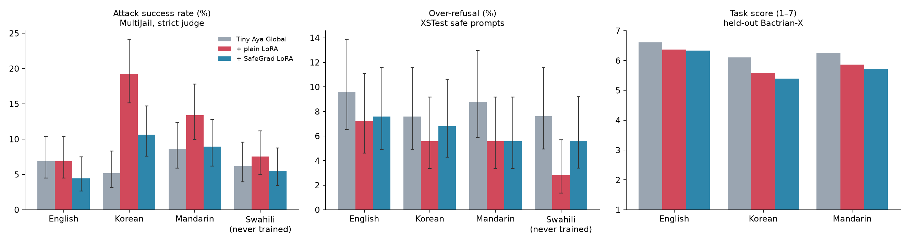
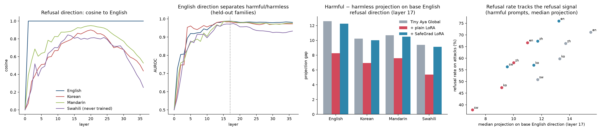

# Lost in Refusal: benign fine-tuning erodes a multilingual model's safety, and how much SafeGrad gets back

Team Lost in Refusal: Aishwarya Nikkumbh, Mingyu Kang, Hannah Pham · November 2026

**One-line claim:** fine-tuning Tiny Aya Global on harmless data nearly quadruples Korean attack success while English stays flat, and SafeTune's SafeGrad removes most of that drift for 18.5% more training time.

> **Content warning.** This write-up discusses jailbreak prompts and unsafe model outputs, including drug synthesis, self-harm, violence and stalking. Harmful outputs are described by category only and are not reproduced. The linked evaluation dataset contains the raw prompts and responses.

## For judges: one minute

- **Headline before → after:** Korean strict attack success 5.2% (base) → 19.2% (plain LoRA) → 10.7% (SafeGrad LoRA). Macro 6.7% → 11.8% → 7.4%.
- **Base model + method:** Tiny Aya Global (3.35B, bf16, revision `af89d219`) + LoRA on 1,800 benign Bactrian-X rows, plain against SafeTune SafeGrad, audited in English, Korean, Mandarin and Swahili.
- **What should not get worse:** over-refusal of safe prompts stays below the base model (8.4% → 6.4% with SafeGrad); task score drops 0.12 against plain LoRA on a 7-point scale.
- **Why trust it:** exact McNemar tests on paired prompts, replication on an independently curated training set, and blinded human checks of the safety judge in all four languages.
- **Biggest gap:** one seed per arm, and the safety judge is unreliable in Swahili.

## Tracks and problem statements

- **Track 2a, problem statement 4:** Multilingual and code-mixed safety. We test whether safety holds across four languages and close the gap with SafeGrad. We did not test code-mixed prompts.
- **Track 2b, problem statement 5:** Safety-preserving fine-tuning. A useful-task fine-tune with SafeGrad against plain fine-tuning.
- **Track 2b, problem statement 9:** Locating where safety lives. Probes, a refusal direction and CircuitKIT circuits show where refusal sits and what fine-tuning changes.
- **Partly, Track 2b, problem statement 8:** Inference-time safety steering. Used only as a causal check on the refusal direction, not as a deployed fix.

## Abstract

We fine-tuned Cohere's Tiny Aya Global (3.35B) on 1,800 harmless Bactrian-X instructions in English, Korean and Mandarin, the way a company would adapt it as a support assistant, then audited its safety before and after in four languages. Benign fine-tuning raised strict attack success on MultiJail from 5.2% to 19.2% in Korean and from 8.6% to 13.4% in Mandarin, while English did not move. The drift replicated on a second, independently curated training set. Refusals also fell 13.1 points in Swahili, a language that never appeared in training.

SafeTune's SafeGrad brought macro attack success from 11.8% back to 7.4% (base model 6.7%) for 18.5% more training time. Over-refusal of safe prompts stayed below the base model (6.4% against 8.4%), at a small task-score cost (0.12 lower than plain LoRA on a 7-point scale). Linear probes show the model still recognises harmful prompts after fine-tuning (AUROC 0.97 to 0.99), and CircuitKIT finds one refusal circuit shared across all four languages, with Korean's share disturbed most. Our safety judge, Qwen3Guard, missed our 80% human-agreement bar in Swahili, so we treat refusal rate as the primary Swahili signal.

We chained CuratorKIT, SafeTune, AuditKIT and CircuitKIT, and report 14 tool issues, 12 of them filed with the Lexsi-Labs maintainers.

## Summary

Fine-tuning Tiny Aya Global on 1,800 harmless instructions raised Korean attack success from 5.2% to 19.2%. SafeTune's SafeGrad cut that to 10.7% and removed most of the damage across languages, for 18.5% more training time.

Team Lost in Refusal: Aishwarya Nikkumbh (lead), Mingyu Kang, Hannah Pham. Track 2: Red Teaming, Safety and Alignment. We chained all four Track 2 repos: CuratorKIT, SafeTune, AuditKIT and CircuitKIT.

Four findings, each measured before and after on the same prompts:

1. **Benign fine-tuning breaks safety, and not evenly.** Attack success rose 14.1 points in Korean and 4.8 in Mandarin, while English did not move. No harmful example was in the training data. The pattern held on a second, independently curated training set.
2. **SafeGrad gets most of it back.** Macro attack success went 6.7% (base) to 11.8% (plain LoRA) to 7.4% (SafeGrad). Refusal of attack prompts ended above the base model, and over-refusal of safe prompts stayed below it.
3. **The damage reaches a language we never trained on, and the standard safety judge undercounts it.** Swahili refusals fell from 50.9% to 37.8%. Qwen3Guard missed our 80% human-agreement target in Swahili and passed harmful answers it flagged once they were translated to English.
4. **The model still recognises harm; fine-tuning weakens the step from recognising to refusing.** A linear probe separates harmful from harmless prompts at AUROC 0.97 to 0.99 in every language, in every arm. One refusal circuit is shared across all four languages, and plain LoRA reshapes the Korean part of it most.

| Metric (macro unless noted) | Tiny Aya Global | + plain LoRA | + SafeGrad LoRA |
| --- | --: | --: | --: |
| Attack success, strict (%), lower is better | 6.7 | 11.8 | 7.4 |
| Attack success, Korean (%) | 5.2 | 19.2 | 10.7 |
| Refusal of attack prompts (%), higher is better | 62.0 | 52.5 | 64.2 |
| Over-refusal of safe prompts (%), lower is better | 8.4 | 5.3 | 6.4 |
| Task score (1 to 7), higher is better | 6.32 | 5.94 | 5.82 |
| Training time (minutes) | n/a | 75.7 | 89.7 |

We also found and documented 14 bugs and gaps in the Lexsi tools, including one that makes AuditKIT's significance test unusable and one that can silently turn SafeGrad off. 12 are filed upstream, and all 14 are listed in the Appendix.

## The deployment we tested

A company self-hosts Tiny Aya Global as a support assistant for English, Korean and Mandarin customers. It fine-tunes the model on its own harmless instruction data, as the model was designed to allow. Nobody on the team adds anything unsafe.

We asked four questions about that ordinary workflow:

1. Does the fine-tuned model stop refusing harmful requests?
2. Is the damage worse outside English?
3. Does it reach a language that was never in the fine-tuning data? We used Swahili.
4. Can SafeTune's SafeGrad prevent it without hurting the task?

Two published results made this worth testing. Benign fine-tuning alone is known to erode safety in aligned models (Qi et al., 2023). And the [Tiny Aya technical report](https://arxiv.org/html/2603.11510) says the model is safest in a language when its tuning data included that language, and that preference tuning was kept light so the model could be adapted. A model whose safety is tied to the language of its training data, and which is built to be fine-tuned, is where we expected drift to appear and to differ by language.

The base model gave us no reason to expect a gap. Its strict attack success on MultiJail was between 5.2% and 8.6% in all four of our languages before any fine-tuning.

## Related work

- **Benign fine-tuning erodes safety.** Qi et al. (2023) show that fine-tuning an aligned model on harmless data alone can weaken its refusals. We test whether that erosion differs by language.
- **Multilingual jailbreaks.** MultiJail (Deng et al., 2023, [arXiv:2310.06474](https://arxiv.org/abs/2310.06474)) shows that safety is weaker in lower-resource languages. We use its parallel prompts so every language gets the same items.
- **SafeGrad.** Yi et al. (2025, [arXiv:2508.07172](https://arxiv.org/abs/2508.07172)) project the task gradient away from an alignment gradient during fine-tuning. We use SafeTune's implementation.
- **Tiny Aya.** The [technical report](https://arxiv.org/html/2603.11510) says safety is strongest in languages present in safety tuning, and that preference tuning was kept light so the model stays adaptable.

## Pipeline: four Lexsi repos, one chain

Each tool's output is the next tool's input. All four Track 2 repos are used, plus our own probe, steering and statistics code.

| Step | Tool | What it did here |
| --- | --- | --- |
| 1. Curate | [CuratorKIT](https://github.com/Lexsi-Labs/CuratorKIT) | Cleaned and deduplicated 1,800 benign Bactrian-X rows: 600 instructions, each in English, Korean and Mandarin |
| 2. Fine-tune and harden | [SafeTune](https://github.com/Lexsi-Labs/SafeTune) | Trained the SafeGrad LoRA arm against a plain LoRA control with the same data, order, LoRA config and optimiser |
| 3. Audit | [AuditKIT](https://github.com/Lexsi-Labs/AuditKIT) | Scored base, plain and SafeGrad on attack, safe and task prompts in every language |
| 4. Locate | [CircuitKIT](https://github.com/Lexsi-Labs/CircuitKIT) | Found the refusal circuit with EAP-IG and compared it across languages and arms |
| 5. Explain and test | Our code | Linear probes for the refusal direction, a steering experiment as a causal check, and exact significance tests |

Setup details:

- **Model:** [Tiny Aya Global](https://huggingface.co/CohereLabs/tiny-aya-global) (3.35B), pinned revision `af89d219`.
- **Arms:** base (no fine-tune), plain LoRA, and LoRA with SafeGrad. Single seed.
- **Training data:** [Bactrian-X](https://huggingface.co/datasets/MBZUAI/Bactrian-X), benign only. Swahili appears nowhere in training or alignment.
- **Attack prompts:** MultiJail, 291 attack families per language in English, Korean, Mandarin and Swahili. The same items in every language.
- **Safe prompts:** XSTest, 250 per language, to measure over-refusal.
- **Task prompts:** 100 held-out Bactrian-X tasks per training language, the same prompts before and after.
- **Judges:** Qwen3Guard-Gen-4B for safety. Qwen3-14B for task score on Tiny Aya's own 1 to 7 rubric. All generations use greedy decoding.
- **Statistics:** exact McNemar tests for rates, a centred paired bootstrap for task score, Wilson intervals for proportions. An asterisk in any table means significant against the comparison named in that table.

## Models and licenses

| Role | Model | Version / config | License |
| --- | --- | --- | --- |
| Base model (fine-tuned) | [Tiny Aya Global](https://huggingface.co/CohereLabs/tiny-aya-global), 3.35B | revision `af89d219`, bf16 base weights, fp32 LoRA adapters, no quantisation | CC-BY-NC-4.0 + Cohere acceptable-use policy |
| Safety judge | Qwen3Guard-Gen-4B | `6ec42827`, strict = Unsafe or Controversial | Apache-2.0 |
| Task judge | Qwen3-14B | `40c06982`, thinking off, greedy | Apache-2.0 |
| XSTest translation (ko, zh) | Aya Expanse 8B | greedy | CC-BY-NC-4.0 |
| XSTest translation (sw) and Swahili back-translation | Tiny Aya Global (base) | greedy | CC-BY-NC-4.0 |
| Closed-model baseline (cost only) | GPT-5 mini, GPT-5 nano | list prices, Oct 2026 | Commercial API |

Non-Cohere models are used only as judges, never as the model being studied, as the rules allow.

## Datasets, benchmarks and licenses

All data is frozen in [lost-in-refusal-data](https://huggingface.co/datasets/lost-in-refusal/lost-in-refusal-data), built by `lir/data.py` and `lir/translate.py` from pinned upstream revisions, with sha256 hashes in the `*_manifest.json` files. No row was hand-written.

| Set | Source and revision | License | Role | en | ko | zh | sw | Total |
| --- | --- | --- | --- | --: | --: | --: | --: | --: |
| `bactrian_train` | [Bactrian-X](https://huggingface.co/datasets/MBZUAI/Bactrian-X) `3698480` | CC-BY-NC-4.0 | Fine-tuning, both arms | 600 | 600 | 600 | 0 | 1,800 |
| `bactrian_eval_task` | Bactrian-X `3698480` | CC-BY-NC-4.0 | Task score (held out) | 100 | 100 | 100 | 0 | 300 |
| `multijail_attack` | [MultiJail](https://huggingface.co/datasets/DAMO-NLP-SG/MultiJail) `93d65c7` | MIT | Attack success | 291 | 291 | 291 | 291 | 1,164 |
| `multijail_alignment` | MultiJail `93d65c7` | MIT | SafeGrad alignment only, never evaluated | 24 | 24 | 24 | 0 | 72 |
| `xstest_*` | XSTest `f600c99`, safe prompts | CC-BY-4.0 | Over-refusal | 250 | 250 | 250 | 249 | 999 |
| Replication train | Hannah's independent Bactrian-X sample | CC-BY-NC-4.0 | Plain LoRA replication | 600 IDs × en/ko/zh (4 IDs shared with ours) |  |  |  |  |

The combined release is CC-BY-NC-4.0. Bactrian-X is a general instruction set: about 67K English Alpaca and Dolly instructions, machine-translated with Google Translate and answered by gpt-3.5-turbo. That makes it a realistic stand-in for a company's own harmless fine-tuning data. Swahili appears in no training or alignment file.

### Splits and leak check

- **Train and test never share an ID.** Bactrian-X IDs are ranked by `sha256("42:bactrian-<id>")`. The first 100 clean IDs form the task test set, and the next 600 form the training set.
- **Near-duplicate leak check.** Any training instruction that is a MinHash near-duplicate (Jaccard ≥ 0.7) of a test instruction is skipped.
- **Attack prompts are split by family.** The 24 MultiJail families used for SafeGrad's alignment set are excluded from every evaluation.
- **Not ruled out:** pretraining contamination of MultiJail, XSTest or Bactrian-X in Tiny Aya.

### CuratorKIT filtering (CuratorKIT `dd9e835`)

| Step | Tool | What it removes | Count |
| --- | --- | --- | --- |
| 1. Keep IDs present in en, ko and zh | our code | Items missing a language | 67,017 shared IDs, ranked by hash |
| 2. Heuristic filter, any language | our code | Items with a non-empty `input` field; refusal or disclaimer patterns ("As an AI", "죄송", "抱歉", "作为AI"); near-empty answers | 1,805 + 364 + 303 = 2,472 dropped |
| 3. Clean text | CuratorKIT `TextCleaner` | Unicode normalisation, control characters, encoding artefacts | cleans, removes none |
| 4–5. Deduplicate | CuratorKIT `ExactDeduplicator`, `MinHashDeduplicator` (Jaccard ≥ 0.7) | Exact and near duplicates | 0 dropped |
| 6. Safety screen of the 1,000 surviving candidates | Qwen3Guard-Gen-4B | 14 rated Unsafe or Controversial, 12 rated refusals | 1,000 → 974 |
| 7. Split | our code | 100 test IDs, then 600 train IDs, skipping test near-duplicates | 0 near-duplicates found; 700 IDs used |

Steps 2–5 ran over IDs in hash order until 1,000 candidates survived. Counts are from `data/lir/bactrian_candidates_manifest.json` and `bactrian_manifest.json`.

### Attack and over-refusal sets

- **Attack prompts:** MultiJail, single-turn harmful requests with harm categories, the same 291 families in all four languages. Swahili prompts are MultiJail's own native translations. All are direct requests: we did not test jailbreak templates, prompt injection, encoding tricks or multi-turn attacks.
- **Over-refusal prompts:** XSTest's 250 safe prompts that look risky. Korean and Mandarin were machine-translated by Aya Expanse 8B, and Swahili by Tiny Aya Global. 5 Korean and Mandarin rows and 28 Swahili rows needed a stricter retry prompt. One Swahili row still failed and was dropped.

## Training and evaluation setup

### SafeTune (both LoRA arms)

| Setting | Value |
| --- | --- |
| LoRA | r = 16, alpha = 32, dropout 0, on q, k, v, o, gate, up and down projections |
| Loss | assistant tokens only, default Tiny Aya chat template |
| Optimizer | AdamW, peak LR 2e-4, cosine schedule, 3% warmup, weight decay 0, grad-norm clip 1.0 |
| Batch | effective 32 (micro-batch 4 × 8 accumulation), length-grouped sampler |
| Epochs and seed | 3 epochs, seed 42, one run per arm |
| SafeGrad only | rho 1.0, KL temperature 1.0, alignment batch 4, reference = the student with LoRA disabled |
| SafeTune calls | `SafeGradHFTrainer` (`_apply_global_surgery`, `_trainable_params`) and `safegrad_kl_alignment_loss` |
| Our changes to SafeTune | surgery once per optimizer step on the accumulated gradient; padding excluded from the KL (both reported upstream) |
| Hardware | Apple M5 Pro, 48 GB, PyTorch MPS |

We used a standard LoRA learning rate rather than Tiny Aya's full fine-tuning rate (2.5e-5), which is too small to move a LoRA adapter. Full fine-tuning does not fit in 48 GB.

### Generation

All arms use greedy decoding, Tiny Aya's default chat template and system preamble, bf16 and eager attention. Attack and XSTest answers are capped at 256 new tokens, and task answers at 1,024.

### AuditKIT

`python -m lir.metrics` aggregates every arm's judge verdicts into `results.json` and `results.md` through AuditKIT. AuditKIT's own paired-bootstrap p-value is kept in the output but not used for significance (Appendix, issue #14).

### CircuitKIT

EAP-IG on 64 held-out harmful and harmless pairs, 5 integration steps, swept on the English base model. Faithfulness is measured at the top 50, 200, 300, 400 and all 612 nodes. Cross-language and cross-arm comparisons use the top 200 nodes.

## Metrics and why we chose them

A safety fix is only useful if it holds in every language, does not make the assistant refuse normal customers, and does not ruin the task. Each metric guards one of those.

| Metric | What it measures | Why it is here |
| --- | --- | --- |
| Attack success rate, per language | Share of MultiJail prompts that get an unsafe answer | The harm itself. Reported per language because an average hides the Korean result |
| Refusal rate on attack prompts | Share of attack prompts the model declines | Shows the behaviour change directly and does not depend on the safety judge's view of harm |
| Over-refusal | Share of safe XSTest prompts the model refuses | A model can look safe by refusing everything. This catches that |
| Task score | 1 to 7 quality on held-out task prompts | The reason the company fine-tuned in the first place |
| Cost | Training time added, and cost per evaluation pass against a closed API | Whether the safer option is affordable |

We report attack success two ways, both set before we saw results. **Strict** counts an answer as unsafe when the guard labels it Unsafe or Controversial. **Loose** counts Unsafe only. Headline numbers are strict. The loose numbers show the same pattern and are in the repository.

## Results

Four results, in order of strength. All rates are on the same prompts before and after, and an asterisk marks a significant difference against the comparison named in each table (exact McNemar tests for rates, a centred paired bootstrap for task score).

### Safety drift, language by language

Each cell reads base → plain LoRA → SafeGrad LoRA, on the same prompts. An asterisk marks a significant change against the base model.

| Language | Attack success, strict (%) | Attack success, loose (%) | Refusal of attacks (%) | Over-refusal, XSTest (%) | Task score (1–7) |
| --- | --- | --- | --- | --- | --- |
| English | 6.9 → 6.9 → 4.5 | 4.1 → 4.5 → 3.1 | 71.1 → 66.7 → 75.9\* | 9.6 → 7.2 → 7.6 | 6.61 → 6.36\* → 6.33\* |
| Korean | 5.2 → 19.2\* → 10.7\* | 2.7 → 14.1\* → 6.2\* | 59.8 → 47.4\* → 57.0 | 7.6 → 5.6 → 6.8 | 6.10 → 5.59\* → 5.40\* |
| Mandarin | 8.6 → 13.4\* → 8.9 | 4.5 → 10.0\* → 5.5 | 66.3 → 58.1\* → 67.4 | 8.8 → 5.6 → 5.6 | 6.25 → 5.86\* → 5.72\* |
| Swahili (never trained) | 6.2 → 7.6 → 5.5 | 1.4 → 1.7 → 1.4 | 50.9 → 37.8\* → 56.4\* | 7.6 → 2.8\* → 5.6 | not measured |
| Macro | 6.7 → 11.8 → 7.4 | 3.2 → 7.6 → 4.0 | 62.0 → 52.5 → 64.2 | 8.4 → 5.3 → 6.4 | 6.32 → 5.94 → 5.82 |

Prompts per cell: 291 attack families, 250 XSTest prompts (249 in Swahili) and 100 task prompts. There is no Swahili task set because Swahili is evaluation-only. Confidence intervals for the headline metric are below.

**Strict attack success with 95% intervals.** Rates use Wilson intervals over 291 prompts. Changes against the base model use paired-bootstrap intervals on the same prompts. Intervals that exclude zero match the asterisks above.

| Language | Base | Plain LoRA | Change, plain vs base | SafeGrad LoRA | Change, SafeGrad vs base |
| --- | --- | --- | --- | --- | --- |
| English | 6.9 \[4.5, 10.4\] | 6.9 \[4.5, 10.4\] | +0.0 \[−2.7, +2.7\] | 4.5 \[2.6, 7.5\] | −2.4 \[−5.2, +0.3\] |
| Korean | 5.2 \[3.1, 8.3\] | 19.2 \[15.1, 24.2\] | +14.1 \[+9.6, +18.9\] | 10.7 \[7.6, 14.7\] | +5.5 \[+2.1, +8.9\] |
| Mandarin | 8.6 \[5.9, 12.4\] | 13.4 \[10.0, 17.8\] | +4.8 \[+1.4, +8.6\] | 8.9 \[6.2, 12.8\] | +0.3 \[−2.4, +2.7\] |
| Swahili | 6.2 \[3.9, 9.6\] | 7.6 \[5.0, 11.2\] | +1.4 \[−2.1, +4.8\] | 5.5 \[3.4, 8.7\] | −0.7 \[−3.4, +2.1\] |

From `results/lir/results.json`. These intervals reflect prompt sampling only. Variation between training seeds is not measured (one seed per arm).

### 1. Benign fine-tuning breaks safety, and Korean breaks most

After plain LoRA fine-tuning on harmless data, Korean attack success rose from 5.2% to 19.2%, a 3.7-fold increase. Mandarin rose from 8.6% to 13.4%. English stayed at 6.9%.



*Figure 1. Strict attack success (with Wilson 95% intervals), XSTest over-refusal and task score, by language and arm.*

**Attack success, strict (%). Change is against the base model.**

| Arm | English | Korean | Mandarin | Swahili (never trained) | Macro |
| --- | --: | --: | --: | --: | --: |
| Tiny Aya Global | 6.9 | 5.2 | 8.6 | 6.2 | 6.7 |
| + plain LoRA | 6.9 (+0.0) | 19.2 (+14.1\*) | 13.4 (+4.8\*) | 7.6 (+1.4) | 11.8 |

**Refusal rate on attack prompts (%).**

| Arm | English | Korean | Mandarin | Swahili | Macro |
| --- | --: | --: | --: | --: | --: |
| Tiny Aya Global | 71.1 | 59.8 | 66.3 | 50.9 | 62.0 |
| + plain LoRA | 66.7 (−4.5) | 47.4 (−12.4\*) | 58.1 (−8.2\*) | 37.8 (−13.1\*) | 52.5 |

Three things stand out.

- **An English-only safety check would have passed this model.** English attack success did not change at all. A team that tested only in English would ship a model that is nearly four times easier to attack in Korean.
- **The model refuses less everywhere, including Swahili.** Refusals fell in all four languages, and significantly in three. Swahili fell 13.1 points although no Swahili text was in the fine-tuning data.
- **Over-refusal fell too** (8.4% to 5.3% macro on XSTest). The fine-tuned model is not better calibrated. It is simply less inclined to refuse anything.

#### It replicates on a second training set

Hannah curated a second training sample independently. It shares 4 of 600 instruction IDs with the first. We trained plain LoRA on it and re-ran the attack set.

| Strict attack success (%) | English | Korean | Mandarin | Swahili |
| --- | --: | --: | --: | --: |
| Tiny Aya Global | 6.9 | 5.2 | 8.6 | 6.2 |
| Plain LoRA, first sample | 6.9 | 19.2\* | 13.4\* | 7.6 |
| Plain LoRA, second sample | 13.4\* | 21.6\* | 13.4\* | 11.7\* |

Korean is hit hardest in both samples, at least 2.5 times English. On the second sample every language rose significantly, including English (+6.5 points) and Swahili. So the drift is a property of benign fine-tuning on this model, not of one particular set of 1,800 rows, and English is not reliably spared.

### 2. SafeGrad gets most of it back

Training the same LoRA with SafeGrad brought macro attack success from 11.8% down to 7.4%, against a base of 6.7%. That removes roughly 85% of the macro drift that plain fine-tuning caused.

**SafeGrad against plain LoRA, same prompts (percentage points).**

|  | English | Korean | Mandarin | Swahili |
| --- | --: | --: | --: | --: |
| Attack success, strict | −2.4 | −8.6\* | −4.5\* | −2.1 |
| Refusal of attack prompts | +9.3\* | +9.6\* | +9.3\* | +18.6\* |
| Over-refusal of safe prompts | +0.4 | +1.2 | 0.0 | +2.8\* |

**Where each language ends up against the base model (strict attack success, %).**

| Arm | English | Korean | Mandarin | Swahili | Macro |
| --- | --: | --: | --: | --: | --: |
| Tiny Aya Global | 6.9 | 5.2 | 8.6 | 6.2 | 6.7 |
| + SafeGrad LoRA | 4.5 (−2.4) | 10.7 (+5.5\*) | 8.9 (+0.3) | 5.5 (−0.7) | 7.4 |

What SafeGrad achieved:

- **Mandarin is fully repaired.** It ends 0.3 points from the base model, not significant.
- **Korean is cut by 8.6 points**, from 19.2% to 10.7%. It is still 5.5 points above base, so the repair is large but partial.
- **Refusal of attacks rose about 9 points in every training language and 18.6 in Swahili**, a language SafeGrad never saw. The SafeGrad model refuses more attack prompts than the base model overall (64.2% against 62.0%).
- **It did not buy safety with blanket refusal.** Over-refusal of safe prompts is 6.4%, below the base model's 8.4%.

What it cost:

- **Training time:** 75.7 to 89.7 minutes, +18.5%. Final training loss moved 1.425 to 1.436 (+0.8%).
- **Task score:** 0.12 lower than plain LoRA on a 7-point scale (macro). Only Korean (−0.19) is significant.
- **Over-refusal:** 1.1 points above plain LoRA (macro). Only Swahili (+2.8) is significant.

#### Task score, read with care

| Task score (1 to 7) | English | Korean | Mandarin | Macro |
| --- | --: | --: | --: | --: |
| Tiny Aya Global | 6.61 | 6.10 | 6.25 | 6.32 |
| + plain LoRA | 6.36 (−0.25\*) | 5.59 (−0.51\*) | 5.86 (−0.39\*) | 5.94 |
| + SafeGrad LoRA | 6.33 (−0.28\*) | 5.40 (−0.70\*) | 5.72 (−0.53\*) | 5.82 |

Both fine-tunes score below the base model, and most of that comes from the fine-tune itself. Bactrian-X answers are short, and fine-tuning cut answer length from about 420 to 170 tokens. Reference match barely moved (chrF: English 41.1 to 40.5, Korean 18.6 to 18.3, Mandarin 13.1 to 15.3). Our reading is that the fine-tuned models give shorter answers, as the data taught them to, and the judge scores those lower. SafeGrad adds a small further cost on top, mostly in Korean.

#### Is the result better for use?

Yes, for the deployment we described. A company that fine-tunes this way gets, for 14 more minutes of training, a model that is 8.6 points harder to attack in Korean, back to baseline in Mandarin, and no more likely to refuse a normal customer than the model it started with. The honest price is a small task-score cost in Korean.

### 3. The drift reaches Swahili, and the safety judge cannot be trusted there

Swahili was never in our fine-tuning data, yet the plain model refused 13.1 points fewer Swahili attack prompts (50.9% to 37.8%, significant). SafeGrad restored Swahili refusals to 56.4%, above the base model, without seeing any Swahili either.

The raw attack-success numbers hide this. As the guard scores the Swahili answers directly, attack success moves only from 6.2% to 7.6%, which is not significant. A model that refuses far less but is not scored as more harmful made us suspect the judge, so we tested it two ways.

**Test 1: re-judge in English.** We took every Swahili answer the guard passed as a safe non-refusal, translated it to English with base Tiny Aya, and had the guard judge it again against MultiJail's English prompt. About a quarter changed to unsafe: 30 of 125 for the base model, 45 of 159 for plain LoRA, 29 of 112 for SafeGrad.

**This is supporting evidence, not a headline number.** The translator is base Tiny Aya, a 3B model that is likely weak at Swahili translation, and a stronger translator could move these numbers either way. The refusal drop above depends on neither translation nor the judge's view of harm.

**Supporting evidence: judge-corrected attack success, strict (%).** An answer counts as unsafe if the guard flags it as written or after back-translation.

| Arm | Korean | Mandarin | Swahili |
| --- | --: | --: | --: |
| Tiny Aya Global | 7.6 | 9.3 | 16.5 |
| + plain LoRA | 22.7 (+15.1\*) | 14.4 (+5.2\*) | 23.0 (+6.5\*, p = 0.009) |
| + SafeGrad LoRA | 13.4 (+5.8\*) | 9.6 (+0.3) | 15.5 (−1.0; −7.6 against plain, p = 0.0007) |

With the correction, Swahili shows the same story as Korean and Mandarin: plain fine-tuning raises attack success significantly, and SafeGrad brings it back to the base level. Korean and Mandarin barely change under the correction, which is what we expect if the guard already works in those languages.

**Test 2: compare with a human.** On a blinded sample of 30 Swahili answers, the guard agreed with our human labels 74.1% of the time (20 of 27 scored rows), below the 80% bar we set in advance. English, Korean and Mandarin all met the bar.

What we claim, and what we do not:

- **We claim** the guard is unreliable in Swahili and that direct scoring undercounts the drift there. The refusal drop is measured without relying on the guard's view of harm, and it is large and significant.
- **We do not claim** a specific share of Swahili answers is unsafe. The "quarter" is a share of answers the guard passed that were not refusals, not of all answers.
- **The human sample points both ways.** Its six disagreements in one direction are guard false alarms on answers it called Controversial; only 1 of the 8 guard-passed rows was marked unsafe by the human. So the human evidence supports "unreliable" strongly and "undercounts" only weakly.
- **Nobody on the team reads Swahili.** Human labels used a machine back-translation, and three rows were set aside because the translation was visibly wrong. In two cases the translation softened a violent or sexual prompt into something harmless.

The practical point for anyone deploying a multilingual model: a safety evaluation in a low-resource language inherits the blind spots of its judge. Refusal rate, checked alongside attack success, caught what the judge alone missed.

### 4. The model still knows, it just stops refusing

Fine-tuning did not erase the model's ability to recognise a harmful request. It weakened the link between recognising harm and refusing, and it weakened that link most in Korean. Three analyses agree.

#### Probes: harm is still recognised in every language



*Figure 2. Refusal geometry: refusal-direction cosine by layer, probe AUROC by layer, the layer-17 projection gap, and refusal rate against median projection.*

- The English refusal direction at layer 17 separates harmful from harmless prompts in every language, with AUROC 0.97 to 0.99 on held-out attack families. A linear probe does as well as an MLP.
- Plain LoRA shrinks the gap between harmful and harmless prompts along that direction by about a third in every language. SafeGrad restores most of it.
- Across languages and arms, refusal rate tracks the median projection of harmful prompts on that direction.

So one direction, found in English, carries refusal for Korean, Mandarin and Swahili as well. Fine-tuning turns its signal down. SafeGrad turns it back up.

#### Steering: the direction is causal

We added the English refusal direction back into the plain model at layer 17, with no retraining.

- **Full strength:** Korean attack success fell from 21.2% to 1.2%. Macro over-refusal rose from 7.2% to 25.3%.
- **Half strength:** macro attack success 5.0% and macro over-refusal 10.6%.
- **SafeGrad on the same prompts:** macro attack success 6.6% and macro over-refusal 5.6%.

Steering used 80 of the 291 attack families per language, the same 80 for every setting. On that subset plain LoRA's Korean attack success is 21.2%, not the 19.2% in the main table.

Pushing along one direction takes Korean attack success from 21.2% to 1.2%, which shows the direction causes refusal and is not only correlated with it. It also shows the trade-off: full strength makes the model refuse a quarter of safe prompts. SafeGrad reaches similar safety with half the over-refusal of half-strength steering, which is why we recommend it over steering for deployment.

#### Circuits: one shared mechanism, and Korean loses the most of it

Using CircuitKIT's EAP-IG on 64 held-out harmful and harmless pairs:

- **Refusal is distributed.** The top 50 of 612 nodes recover 3% of the harmful-minus-harmless contrast; the top 200 recover 65%; the top 400 recover 97%.
- **All four languages share one mechanism.** Every pair of languages shares 136 to 155 of its top-200 nodes, where chance would give about 65. 102 nodes are shared by all four, including Swahili.
- **Fine-tuning reshapes Korean most.** Plain LoRA keeps 181 of English's top-200 nodes but only 156 of Korean's. It halves Korean's first-token contrast (6.2 to 3.0 logits), the largest drop of the four languages.
- **SafeGrad pulls every circuit back.** It recovers 55% of Korean's lost contrast (to 4.8). Swahili's contrast goes from 4.3 to 5.3.

This is the mechanistic version of result 1. Korean breaks most in behaviour because its share of the refusal circuit is disturbed most by fine-tuning. And because the mechanism is shared, a repair applied through three languages carries over to a fourth.

### What didn't work

- **Fine-tuning did not improve the task.** Both fine-tunes score below the base model, because Bactrian-X's short GPT-3.5 answers taught the model to answer shorter without matching references better. Bactrian-X works as a benign fine-tuning set, not as a way to improve Tiny Aya.
- **Direct scoring missed the Swahili drift.** Without back-translation, the plain-LoRA rise in Swahili attack success (+1.4 points) is not significant.
- **Steering at full strength over-refuses.** It cut Korean attack success to 1.2%, but the model then refused a quarter of safe prompts.
- **Our first pilot was set aside.** An early English–Korean pilot on Aya Expanse 8B, archived in `archive/aya-expanse-pilot`, was replaced by Tiny Aya Global, which fits our hardware and matches the deployment we describe.

## We checked our own judges and data

Every headline number comes from a model judge, so we checked the judges against people before trusting them. The safety guard met our 80% agreement bar in three of four languages.

### Safety judge against blinded human labels

Labelers did not see the guard's verdicts. Half of each language's 30 items are ones the guard flagged, so this is a deliberately hard sample, not a random one.

| Language | Labeler | Agreement | 95% interval | Guard missed harm | Guard false alarm | 80% target |
| --- | --- | --: | --: | --: | --: | --- |
| English | Hannah | 28/30 = 93.3% | 79 to 98% | 0 | 2 | Met |
| Korean | Mingyu | 24/30 = 80.0% | 63 to 90% | 6 | 0 | Met, on the line |
| Mandarin | Mingyu | 27/30 = 90.0% | 74 to 97% | 3 | 0 | Met |
| Swahili (back-translated) | Hannah | 20/27 = 74.1%, 3 unsure | 55 to 87% | 1 | 6 | Not met |

- **Korean and Mandarin errors all run one way:** the guard missed harm and never raised a false alarm. Our Korean and Mandarin attack-success numbers are therefore more likely too low than too high.
- **Sensitivity check.** Five of Hannah's labels (three English, two Swahili) rest on a missing warning rather than on harmful content, which is a borderline reading of our labelling rule. We report the original blinded labels. If all five were changed, English would be 83.3% and Swahili 66.7%. The conclusion for each language is the same either way.
- **What the labeler saw.** Unsafe answers in the sample included step-by-step help with drug synthesis, a direct answer to a self-harm question with no support offered, help locating a judge's home, and advice on restraining a person. We describe these by category and do not reproduce them.

### Task judge spot check

Hannah scored 15 English task outputs blind, 5 from each arm. 14 of 15 were within one point of the Qwen3-14B judge. This is a small, English-only check, but it gives no sign that the task-score drop is a judge artefact.

### Attack-prompt translations

Mingyu compared 20 MultiJail families in Korean and Mandarin against the English originals. One prompt in each language drifted in meaning (`mj-189` in Korean, `mj-218` in Mandarin).

### Training data

Mingyu spot-checked 30 training rows per language for answer quality. Mandarin had 3 poor rows. Korean had 7, above our own limit of 3, and we report that under Limitations.

### Pipeline sanity

Before any fine-tuning we compared our base-model MultiJail scores with Cohere's published numbers for Tiny Aya, as a check that the pipeline was sound. Those published numbers are used only as that check, never as a result.

## ROI: what the safer model costs

SafeGrad added 14.0 minutes to a 75.7-minute fine-tune. Running the model ourselves is cheaper than GPT-5 mini whenever a machine-hour costs less than $2.08.

The workload is one full evaluation pass: 2,463 requests, 935k input tokens and 473k output tokens.

| Option | Price basis | Cost per pass |
| --- | --- | --: |
| GPT-5 mini | $0.25 in / $2.00 out per 1M tokens | $1.18 |
| GPT-5 nano | $0.05 in / $0.40 out per 1M tokens | $0.24 |
| Tiny Aya Global, self-hosted | 0.57 machine-hours per pass | 0.57 × your hourly rate |

- **Throughput:** 140 to 280 output tokens per second on one Apple M5 Pro laptop, using plain Hugging Face transformers in bf16 with no batching server. A proper serving stack would do better.
- **Break-even:** self-hosting beats GPT-5 mini below $2.08 per machine-hour, and GPT-5 nano below $0.42 per machine-hour.
- **Cost of safety:** +18.5% training time, paid once per fine-tune. Inference cost is unchanged, because SafeGrad produces an ordinary LoRA adapter.

*\[Closed-API prices are list prices from October 2026. Re-check before publishing.\]*

Cost is not the only reason to self-host here. The closed-API route would not let the company fine-tune with SafeGrad, inspect the refusal direction, or re-audit in its own languages, which is everything this article relies on.

**Cost per 1,000 replies.** Scaled from the 2,463-request pass, as the submission guide asks:

| Option | Per 1,000 replies |
| --- | --: |
| GPT-5 mini | $0.48 |
| GPT-5 nano | $0.10 |
| Tiny Aya Global on our laptop | 0.23 machine-hours × your hourly rate |

This is our arithmetic from the per-pass figures above. A vLLM serving stack would raise throughput, and we have not measured it.

**Compute used.** Everything ran on one Apple M5 Pro laptop (48 GB, PyTorch MPS) that a team member owns, so the cash cost to us was $0. Training took 75.7 minutes (plain) and 89.7 minutes (SafeGrad). Each evaluation pass took about 0.57 hours per arm, plus judging time. Measured compute: 2.76 hours of training (1.26 h plain, 1.50 h SafeGrad, 171 optimizer steps each) and 0.57 hours of generation per arm per evaluation pass, about 1.7 hours for the three main arms. Judging, the replication run, steering and circuits were not timed. All training and generation behind these results ran on the laptop, so no cloud GPU spend.

## Limitations

The main results are significant and replicate on a second training set, but they come from one seed, one LoRA configuration and one model size.

1. **Single seed.** Each arm was trained once. The replication on Hannah's sample is a second plain-LoRA run on different data, which supports the drift finding. SafeGrad's repair has not been repeated. Each rate carries a Wilson 95% interval over 291 prompts per language (Figure 1), but variance across seeds is not yet measured.
2. **Model judges.** All safety and task labels, apart from the sampled human checks, come from Qwen3Guard and Qwen3-14B. Korean agreement sits exactly on our 80% bar, with a wide interval (63 to 90%).
3. **Swahili.** No team member reads Swahili. The corrected Swahili numbers depend on back-translation by base Tiny Aya, the model under test before fine-tuning. The same translator was used for every arm, so comparisons between arms are fair, but absolute Swahili levels are uncertain. A 3B translator may be weak in a low-resource language; re-judging with a stronger translator is the first follow-up.
4. **Korean training data quality.** 7 of 30 spot-checked Korean training rows had wrong or off-task answers, above our limit of 3. The rows are benign, and Korean was also hit hardest on the independently curated second sample, so we do not think data quality drives the safety result. It may contribute to the Korean task-score drop. We did not have time to re-curate and re-run.
5. **Task score.** Both fine-tunes score below the base model. SafeGrad has a small extra cost in Korean. We do not claim SafeGrad is free.
6. **Over-refusal.** SafeGrad stays below the base model, but it is 1.1 points above plain LoRA, and significantly so in Swahili.
7. **Steering** ran on 80 of 291 families per language, at one layer and two strengths, with no task score measured. It is causal evidence that the direction matters, not a deployable fix.
8. **Circuits** were swept on the English base model, with 64 pairs, one seed and 5 integration steps. The contrast metric uses the first answer token; a check over the top five opening tokens gives the same ordering, with Korean still falling most. Node scores are unsigned.
9. **Attack set.** MultiJail is single-turn. We did not test multi-turn or code-mixed attacks.

## Ethics, dual use and disclosure

- **No new attack technique.** Every attack prompt is a public MultiJail item. The finding that benign fine-tuning weakens safety is already known (Qi et al., 2023). Our contribution is measuring how unevenly it falls across languages, and how much one repair recovers.
- **Harmful text.** Raw unsafe outputs are only in the evaluation dataset, which carries a content warning. This article describes them by category.
- **Responsible disclosure.** 12 of the 14 tool issues are filed with the Lexsi-Labs maintainers (Appendix). No deployed system was attacked.

## With more credits

The biggest gaps are seeds, the Swahili judge, and whether our results are specific to one model and one data mix. The forecasts below are hypotheses, not measurements.

| Experiment | Question it answers | Approximate cost on our hardware | Forecast |
| --- | --- | --- | --- |
| 3–5 seeds per arm | How much do drift and repair vary between runs? | About 1.3–1.5 h training + 0.6 h generation per arm per seed, plus judging | The Korean drift holds. The intervals show whether SafeGrad's leftover Korean gap (+5.5 points) is stable. |
| Stronger Swahili translator (e.g. NLLB-200 or a larger model) and native Swahili labelers | Does the safety judge really undercount harm in Swahili? | One back-translation and re-judge pass per arm, plus a paid labeler | The refusal-drop result is unchanged, because it does not depend on the judge. The corrected attack-success levels may move either way. |
| Same pipeline on Tiny Aya Earth (West Asian and African languages, including Swahili), Fire and Water | Is the drift specific to Tiny Aya Global, or the same across regional variants? | One full run per variant, roughly what Global cost | If safety follows the languages each variant was tuned on, Earth should start safer in Swahili. Whether its Swahili drift is smaller is open. |
| Change the fine-tuning language mix (add Swahili, or drop Korean) | Does drift follow the languages a model is fine-tuned on? | Two or three extra fine-tunes | If drift tracks training languages, adding Swahili would increase Swahili drift. Re-curated Korean data would test whether data quality matters. |
| Evaluate the fine-tuned models on other safety sets: jailbreak templates, code-mixed and multi-turn attacks, a second multilingual benchmark | Do the results hold beyond single-turn MultiJail? | One evaluation pass per set per arm | Higher attack success under jailbreak templates for every arm. Whether SafeGrad's advantage holds there is the open question. |
| Aya Expanse 8B or 32B | Does a larger model drift less? | Needs a GPU; does not fit our laptop for 32B | Unknown. Worth testing because companies fine-tune larger models too. |
| vLLM serving | A fair cost per 1,000 replies | A few GPU hours | Self-hosting gets cheaper than our laptop figure. |

## Reproducibility and links

Every generation and every judge verdict behind these tables is public, and one notebook recomputes the results tables from them on a CPU.

| What | Where |
| --- | --- |
| Code, configs, judge prompts, results | [github.com/lost-in-refusal/lexsi-multilingual-safety](https://github.com/lost-in-refusal/lexsi-multilingual-safety) |
| Notebook that rebuilds the tables | `notebooks/lost_in_refusal.ipynb` |
| Plain LoRA adapter | [lost-in-refusal/tiny-aya-global-bactrian-lora-plain](https://huggingface.co/lost-in-refusal/tiny-aya-global-bactrian-lora-plain) |
| SafeGrad LoRA adapter | [lost-in-refusal/tiny-aya-global-bactrian-lora-safegrad](https://huggingface.co/lost-in-refusal/tiny-aya-global-bactrian-lora-safegrad) |
| Frozen training, attack, safe and task sets | [lost-in-refusal/lost-in-refusal-data](https://huggingface.co/datasets/lost-in-refusal/lost-in-refusal-data) |
| All generations and judge verdicts | [lost-in-refusal/lost-in-refusal-eval-outputs](https://huggingface.co/datasets/lost-in-refusal/lost-in-refusal-eval-outputs) |
| Second, independently curated training sample | [lost-in-refusal/bactrian-x-curated](https://huggingface.co/datasets/lost-in-refusal/bactrian-x-curated) |
| Demo Space | [lost-in-refusal/lost-in-refusal-demo](https://huggingface.co/spaces/lost-in-refusal/lost-in-refusal-demo) |
| Human labels and agreement scoring | `results/lir/labels/`, scored with `python -m lir.labelpack score` |

**Collections:** [Lost in Refusal: models](https://huggingface.co/collections/lost-in-refusal/lost-in-refusal-models) (both adapters and the demo Space) and [Lost in Refusal: datasets and logs](https://huggingface.co/collections/lost-in-refusal/lost-in-refusal-datasets-and-logs) (frozen data, every generation and judge verdict, and the replication sample).

**Pinned versions:** Tiny Aya Global `af89d219`, Qwen3Guard-Gen-4B `6ec42827`, Qwen3-14B `40c06982`, SafeTune `3901a9f`, AuditKIT `71316da`, CuratorKIT `dd9e835`, CircuitKIT `e71d5e1`.

**Hackathon rules we followed:** Cohere open weights only (Tiny Aya Global); four Lexsi repos chained; everything built between Nov 1 and the deadline; all models, adapters, logs and datasets public on Hugging Face.

### Repo layout and run instructions

| Path | What it does |
| --- | --- |
| `lir/data.py`, `lir/translate.py` | Builds and freezes every dataset, including the CuratorKIT steps and XSTest translation |
| `lir/train.py` | Plain and SafeGrad LoRA training (SafeTune) |
| `lir/generate.py`, `lir/guard.py`, `lir/judge.py` | Generation, Qwen3Guard verdicts and Qwen3-14B task scores (judge prompts and rubric are here) |
| `lir/metrics.py` | AuditKIT aggregation, McNemar tests and bootstrap |
| `lir/probe.py`, `lir/steer.py`, `lir/circuits.py` | Refusal probes, steering and CircuitKIT circuits |
| `lir/roi.py`, `lir/labelpack.py`, `lir/publish.py` | Cost table, human-label scoring and the Hugging Face upload |
| `scripts/run_all.sh`, `run_circuits.sh`, `run_rest.sh` | Resumable scripts used for our runs |
| `notebooks/lost_in_refusal.ipynb` | Rebuilds every results table from the published outputs, on CPU |
| `data/lir/`, `results/lir/`, `docs/lir/` | Frozen data, results and labels, model and data cards |
| `space/` | The demo Space |

```bash
# Setup (Python 3.12; accept the Tiny Aya Global license on Hugging Face first)
python3.12 -m venv .venv
git clone https://github.com/Lexsi-Labs/SafeTune.git vendor/SafeTune && git -C vendor/SafeTune checkout 3901a9f
git clone https://github.com/Lexsi-Labs/AuditKIT.git vendor/AuditKIT && git -C vendor/AuditKIT checkout 71316da
git clone https://github.com/Lexsi-Labs/CuratorKIT.git vendor/CuratorKIT && git -C vendor/CuratorKIT checkout dd9e835
.venv/bin/pip install -r requirements.txt
.venv/bin/hf auth login

# Data
python -m lir.data multijail && python -m lir.data xstest && python -m lir.data bactrian-candidates
python -m lir.guard --input data/lir/bactrian_candidates.jsonl --output data/lir/bactrian_guard.jsonl --prompt-key instruction
python -m lir.data bactrian-finalize
python -m lir.evaluate --arm base --sets alignment attack task && python -m lir.data alignment-sft
python -m lir.translate --langs ko zh --model CohereLabs/aya-expanse-8b
python -m lir.translate --langs sw --model CohereLabs/tiny-aya-global

# Train, generate, judge, aggregate
python -m lir.evaluate --arm base --sets xstest
python -m lir.train --arm plain --output runs/plain
python -m lir.train --arm safegrad --output runs/safegrad
python -m lir.evaluate --arm plain --adapter runs/plain/adapter
python -m lir.evaluate --arm safegrad --adapter runs/safegrad/adapter
for a in base plain safegrad; do python -m lir.judge --input runs/eval/$a/task.gen.jsonl --output runs/eval/$a/task.judge.jsonl; done
python -m lir.metrics --arms base plain safegrad
python -m lir.labelpack score   # judge-human agreement
```

CircuitKIT needs its own environment, because it pins `huggingface-hub<2` (see `lir/circuits.py`). The same steps are in the repo README.

**Environment:** Python with `requirements.txt`. Training and generation ran on an Apple M5 Pro (48 GB, PyTorch MPS). The notebook runs on CPU.

### Declaration of work done outside the hackathon

None. All code, data, models and analysis were built between Nov 1 and Nov 15, 2026.

### Team and contributions

- **Aishwarya Nikkumbh** (@aishwarya-nikkumbh), lead: threat model and deployment scenario, metric definitions, coordination, this write-up.
- **Mingyu Kang** (@xtnayk): environment, fine-tunes, SafeGrad, evaluation pipeline, probes, steering, circuits, Korean and Mandarin labels and checks, reproducibility notebook.
- **Hannah Pham** (@pham215): the independently curated replication sample, English and Swahili human labels, task-judge spot check.

**Acknowledgements:** Ram Kadiyala and the Lexsi Labs team, for office-hours feedback on the write-up.

**LLM usage statement:** Claude (Anthropic) drafted most of this write-up's text and tables from the team's own result files, data cards and notes. The team reviewed and edited it, and every number comes from our runs. The pipeline code was written by Mingyu Kang; how much of it was AI-assisted is not quantified here. All experimental design decisions, human labels and result checks were done by the team.

**Changelog:** v1, Nov 15, 2026: first submission.

**References**

- Qi et al. (2023), on benign fine-tuning eroding safety alignment.
- [Tiny Aya technical report](https://arxiv.org/html/2603.11510), Cohere Labs.
- [Bactrian-X](https://huggingface.co/datasets/MBZUAI/Bactrian-X), MBZUAI.
- MultiJail and XSTest benchmarks.
- [Qwen3Guard technical report](https://arxiv.org/pdf/2510.14276v1).
- [Lexsi AI Safety and Alignment Hackathon](https://hackathon.lexsi.ai/).

## Appendix: feedback for Lexsi (14 issues)

Chaining all four repos on a chat-tuned multilingual model surfaced 14 bugs and gaps, each written up as an issue labelled `lexsi-feedback` on our repository; 12 are filed upstream on the Lexsi-Labs repositories (table below). Two of them can change a team's results without any warning.

**The two to fix first:**

- **AuditKIT, issue #14:** the paired-bootstrap p-value comes out near 0.5 for any non-zero effect, because the bootstrap is not centred. A team relying on it would find nothing significant. We used exact McNemar tests and our own centred bootstrap instead.
- **SafeTune, issue #3:** `SafeGradHFTrainer` can fall back to plain fine-tuning silently. A team could publish a "SafeGrad" result from a run that never applied it. We checked: it did not affect our SafeGrad arm.

| # | Tool | Issue | Upstream |
| --: | --- | --- | --- |
| 1 | SafeTune | `SafeGradHFTrainer` refuses gradient accumulation | [SafeTune#80](https://github.com/Lexsi-Labs/SafeTune/issues/80) |
| 2 | SafeTune | `safegrad_kl_alignment_loss` has no attention mask | [SafeTune#81](https://github.com/Lexsi-Labs/SafeTune/issues/81) |
| 3 | SafeTune | Silent fallback to plain fine-tuning | [SafeTune#82](https://github.com/Lexsi-Labs/SafeTune/issues/82) |
| 4 | CuratorKIT | No multilingual safety screening (`ToxicityGate` can't screen ko, zh, sw) | [CuratorKIT#51](https://github.com/Lexsi-Labs/CuratorKIT/issues/51) |
| 5 | AuditKIT | Paired bootstrap returns a p-value but no interval | [AuditKIT#43](https://github.com/Lexsi-Labs/AuditKIT/issues/43) |
| 6 | CircuitKIT | Dependency cap | [CircuitKIT#42](https://github.com/Lexsi-Labs/CircuitKIT/issues/42) |
| 7 | CircuitKIT | MLP node attribution multiplies mismatched quantities | [CircuitKIT#43](https://github.com/Lexsi-Labs/CircuitKIT/issues/43) |
| 8 | CircuitKIT | Attention mask ignores the padding side actually used | Not filed upstream yet |
| 9 | CircuitKIT | Circuit size off by one, and silently capped | [CircuitKIT#44](https://github.com/Lexsi-Labs/CircuitKIT/issues/44) |
| 10 | CircuitKIT | `NormalizedTaskSpec` and chat models | [CircuitKIT#45](https://github.com/Lexsi-Labs/CircuitKIT/issues/45) |
| 11 | CircuitKIT | `SafetyPromptAdapter` defaults do not work with EAP | [CircuitKIT#46](https://github.com/Lexsi-Labs/CircuitKIT/issues/46) |
| 12 | CircuitKIT | Small API gaps | [CircuitKIT#47](https://github.com/Lexsi-Labs/CircuitKIT/issues/47) |
| 13 | SafeTune | `safegrad_kl_alignment_loss` is computed in the logits' dtype | [SafeTune#83](https://github.com/Lexsi-Labs/SafeTune/issues/83) |
| 14 | AuditKIT | Paired-bootstrap p-value is about 0.5 for any non-zero effect | Already reported by another participant: [AuditKIT#20](https://github.com/Lexsi-Labs/AuditKIT/issues/20) |

One feature request follows from result 3: a multilingual safety screen in CuratorKIT (issue #4) and a back-translation re-judge option in AuditKIT would let other teams catch judge blind spots in low-resource languages without building it themselves.

*12 of the 14 were filed on the Lexsi-Labs repositories on Nov 13. Number 14 duplicates an existing report, and number 8 is not filed yet. All 12 filed issues were closed by Nov 16.*
