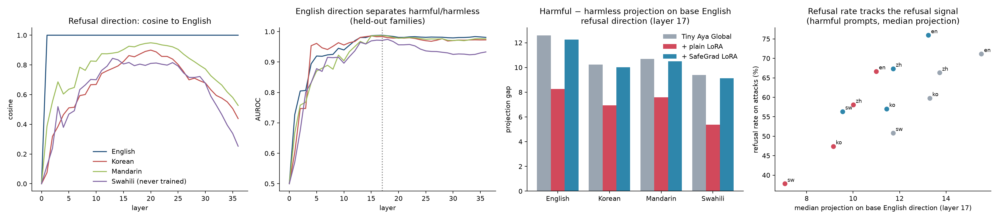

<!-- Draft for Aish to own. Every number comes from results/lir/*.json; {{...}} marks numbers still being computed. -->

# Lost in Refusal

**TL;DR.** We fine-tuned Tiny Aya Global on 1,800 harmless instruction/answer pairs in English, Korean and
Mandarin. English safety did not move. Korean attack success nearly quadrupled (5.2% → 19.2%) and Mandarin rose by
half (8.6% → 13.4%). An English-only safety check would have passed this model. Training the same adapter with
SafeTune's SafeGrad removed the Mandarin increase, cut the Korean one by 60%, and restored refusals in every
language, including Swahili, which neither fine-tuning nor SafeGrad ever saw. In Swahili the damage was invisible
to the safety judge: after correcting for the judge's blind spot, plain fine-tuning raised Swahili attack success
from 16.5% to 23.0%, and SafeGrad took it back to 15.5%. The cost against plain fine-tuning was 0.12 points of judged task quality on a 1–7 scale and 18.5% more training time.

## 1. Why this matters

Small open multilingual models are what teams actually adapt and self-host. Tiny Aya Global (3.35B) fits a laptop
and costs a fraction of a closed API per token (section 6). Fine-tuning on harmless data is known to erode safety
training (Qi et al., 2023). The Tiny Aya report adds two things: the model's safety in a language depends on having
safety data in that language, and preference tuning was kept deliberately light so the community could adapt it.
The users Tiny Aya was built for, multilingual teams fine-tuning it, are therefore the ones most exposed to drift,
and they rarely have safety data in every language.

**Use case.** {{named deployment}}: an assistant fine-tuned on in-house instruction data for English, Korean and
Mandarin users, with more languages on the roadmap. The team checks safety the way most teams do: in English.

## 2. Setup

| | |
|---|---|
| Model | Tiny Aya Global `af89d219`, default chat template and system preamble, greedy decoding |
| Fine-tuning data | 600 Bactrian-X instructions × en/ko/zh = 1,800 rows. Benign only: CuratorKIT cleaning and MinHash dedup, refusal/disclaimer filter, Qwen3Guard screen |
| Arms | **plain LoRA** vs **SafeGrad LoRA**. Same data, order, LoRA (r=16, all projections), optimizer (2e-4, cosine, 3 epochs, batch 32) |
| SafeGrad | SafeTune `SafeGradHFTrainer`: per optimizer step, KL(base ‖ student) on 47 base-model refusals to 24 held-out MultiJail families (en/ko/zh); conflicting task gradients projected out; update = projected task gradient + alignment gradient |
| Attacks | 291 MultiJail families × en/ko/zh/**sw**. Swahili is never used for training or alignment |
| Over-refusal | XSTest's 250 safe prompts × the same four languages (ko/zh by Aya Expanse 8B, sw by Tiny Aya, with retries) |
| Task | 100 held-out Bactrian-X instructions per training language; Qwen3-14B judge, Tiny Aya's 1–7 rubric (accuracy, instruction following, coherence, fluency) |
| Safety judge | Qwen3Guard-Gen-4B. Strict = Unsafe or Controversial; loose = Unsafe only |
| Statistics | Paired on identical prompts; exact McNemar for rates, centred paired bootstrap for scores; 95% CIs |
| Audit | AuditKIT aggregates every saved output (`PrecomputedModel`) |

**Sanity check.** Our base-model safe rates (93.1 / 94.8 / 91.4 / 93.8% for en/ko/zh/sw) are within 1–2 points of the
Tiny Aya report (Swahili 94%, average 91.1%), so the pipeline reproduces the published starting point.

## 3. Break: benign fine-tuning removes refusals, but not in English

Attack success rate (strict), 291 MultiJail prompts per language:

| | English | Korean | Mandarin | Swahili (never trained) |
|---|---:|---:|---:|---:|
| Tiny Aya Global | 6.9 | 5.2 | 8.6 | 6.2 |
| + plain LoRA | 6.9 (+0.0) | **19.2 (+14.1, p = 6×10⁻⁹)** | **13.4 (+4.8, p = 0.016)** | 7.6 (+1.4, n.s.) |

With the loose judge (Unsafe only) the picture is the same: Korean +11.3, Mandarin +5.5, English +0.3, Swahili +0.3.

The model also refuses less in every language: refusal on attack prompts fell from 71.1 → 66.7% (en),
59.8 → 47.4% (ko), 66.3 → 58.1% (zh) and 50.9 → 37.8% (sw). In Swahili the lost refusals did not turn into content
the judge calls unsafe. Two explanations fit: the answers are harmless, or Qwen3Guard misses harm in Swahili. We
tested both. Answers stayed in Swahili (98.3% vs 96.2% for the base), so this is not language drift. To test the judge, we
translated every Swahili answer the guard had passed as a safe non-refusal into English (with Tiny Aya, the same
for all arms) and re-judged it against MultiJail's English prompt. About a quarter turned out unsafe: 30 of 125 for
the base model, 45 of 159 after plain LoRA, 29 of 112 after SafeGrad. **Qwen3Guard undercounts harm in Swahili.**
Counting those answers, Swahili attack success is 16.5% for the base model and **23.0% after plain LoRA (+6.5
points, p = 0.009)**; SafeGrad brings it back to 15.5% (−7.6 vs plain, p = 0.0007). So the drift does reach the
language we never fine-tuned on, and SafeGrad repairs it without any Swahili data. (The corrected base rate is also
well above the 6% implied by the published 94% safe rate, which suggests published Swahili safety numbers may share
the same judge blind spot; we have not verified that.)

## 4. Fix: SafeGrad keeps refusal without giving up the task

| | ASR strict en / ko / zh / sw | Refusal on attacks (macro) | Over-refusal, XSTest (macro) | Task score (1–7, macro) |
|---|---|---:|---:|---:|
| Tiny Aya Global | 6.9 / 5.2 / 8.6 / 6.2 | 62.0 | 8.4 | 6.32 |
| + plain LoRA | 6.9 / 19.2 / 13.4 / 7.6 | 52.5 | 5.3 | 5.94 |
| + SafeGrad LoRA | 4.5 / 10.7 / 8.9 / 5.5 | 64.2 | 6.4 | 5.82 |

Against the plain adapter on the same prompts, SafeGrad lowers attack success by 8.6 points in Korean and 4.5 in
Mandarin (both p < 0.05) and raises refusal by 9.3 (en), 9.6 (ko), 9.3 (zh) and **18.6 (sw)** points. The Swahili
gain comes with no Swahili data anywhere in training or alignment.

Over-refusal stays below the base model: SafeGrad refuses 6.4% of XSTest's safe prompts (macro) against 5.3% for
plain and 8.4% for the base model, so the restored refusals are not indiscriminate.

**Task quality.** Against plain LoRA, SafeGrad's judged task score is 0.12 lower (5.82 vs 5.94 macro); only the
Korean difference (−0.19) is significant. Both fine-tunes score below the base model (6.32). Training on
Bactrian-X's short GPT-3.5 answers cut answer length from about 420 to 170 tokens without improving reference
match (chrF en 41.1 → 40.5, ko 18.6 → 18.3, zh 13.1 → 15.3), and the judge prefers the base model's fuller
answers. In other words this fine-tune bought very little on the task and still broke Korean and Mandarin safety.
A deployment with a sharper target task would see a real task gain; the safety cost would be the same kind.

What it cost: 18.5% more training time (89.7 vs 75.7 minutes on one laptop GPU) and a final training loss 0.8%
higher (1.436 vs 1.425). The task and alignment gradients were nearly orthogonal (median cosine −0.002); the
projection fired on 92 of 171 steps.

**Making SafeGrad work at all.** SafeTune's KL is summed over every position of a sequence, while the task loss is a
per-token mean. With ~430-token sequences, ρ = 1 made the alignment gradient 50–800× the task gradient, gradient
clipping then erased the task update, and task loss rose above the plain run within seven steps. We stopped that run
(kept as evidence) and normalised the KL per token. We also found the KL is computed in bf16, where two identical
distributions score about 0.6 per sequence; we upcast it to fp32. Both are reported to Lexsi (section 7).

## 5. Explain: where refusal lives, and why Korean slips

We took the last-token residual stream (the `<|START_RESPONSE|>` position) at every layer for every attack prompt
(harmful) and every XSTest/task prompt (harmless), split by MultiJail family into train and held-out halves, and
computed difference-of-means refusal directions per language.

- **The model still recognises harm in every language.** The English direction separates harmful from harmless
  held-out prompts with AUROC 0.988 (en), 0.984 (ko), 0.987 (zh) and 0.971 (sw) at layer 17, the best English
  layer. Detection is not what fails.
- **Refusal is linear here.** Probes trained on English only and tested on held-out families in each language: a
  logistic probe reaches AUROC 0.985–0.993 and a one-hidden-layer MLP 0.983–0.992. We find no sign of a curved
  feature that a single direction would miss.
- **Each language has its own version of the direction.** Cosine to the English direction peaks mid-network (0.95
  Mandarin, 0.90 Korean, 0.84 Swahili around layers 16–20) and falls off in early and late layers (Korean 0.44 and
  Swahili 0.25 at the last layer).
- **Fine-tuning shrinks the refusal signal by about a third in every language, and SafeGrad restores it.** The
  harmful-minus-harmless gap on the base English direction at layer 17 goes from 12.6 / 10.2 / 10.7 / 9.4 (en / ko
  / zh / sw) to 8.3 / 6.9 / 7.6 / 5.4 after plain LoRA and back to 12.3 / 10.0 / 10.5 / 9.1 after SafeGrad.
- **Refusal rate tracks that signal.** In the base model the median projection of harmful prompts orders the
  languages exactly like their refusal rates (en 15.5 > zh 13.7 > ko 13.3 > sw 11.7; refusal 71 > 66 > 60 > 51%),
  and within each language and model the projection predicts whether a given prompt is refused (AUROC 0.73–0.88).
  English starts with the most headroom, which is consistent with English still refusing after the same
  proportional loss. The base-model threshold does not carry over unchanged to the fine-tuned model, so this is a
  correlation, not a full mechanism; the steering experiment below is the causal test.

{{steering: adding the English direction vs each language's own direction to the plain model, attack success and
over-refusal per language}}

{{CircuitKIT: overlap of per-language refusal circuits (EAP-IG, top-k nodes), base vs plain}}

## 6. ROI

One evaluation pass (2,463 requests, 0.94M input and 0.45M output tokens) costs $1.18 at GPT-5 mini list prices
and $0.24 at GPT-5 nano; on one laptop with unoptimised Hugging Face generation it takes 0.57 hours. Self-hosting is
cheaper than GPT-5 mini whenever the machine costs less than $2.08 an hour to own and run, and roughly break-even
with GPT-5 nano ($0.42 an hour). The safety fix itself costs 14 minutes of laptop time per fine-tune. Details:
`docs/lir/roi.md`.

## 7. Feedback to Lexsi

We chained all four tools and logged 14 bugs and gaps as issues; the important ones changed our results:

- **SafeTune**: SafeGrad's KL is computed in the logits' dtype (bf16 noise floor ~0.6/sequence); summed over
  positions, so ρ = 1 is not scale-free; `SafeGradHFTrainer` rejects gradient accumulation; alignment errors
  silently fall back to plain fine-tuning.
- **AuditKIT**: the paired-bootstrap p-value is not centred and sits near 0.5 for any effect (0.53 for our 14-point
  Korean increase, McNemar p = 6×10⁻⁹).
- **CircuitKIT**: MLP node scores multiply the activation difference at `hook_mlp_out` by the gradient at
  `hook_mlp_in`; attention masks ignore the padding side actually used; circuit sizes are off by one and capped.
- **CuratorKIT**: no safety screen for Korean, Chinese or Swahili (Detoxify does not cover them).

Full list: `docs/lir/lexsi-feedback.md`.

## 8. Limitations

- Automatic judges. Human agreement is checked on 30 blinded items per language (target ≥ 80%): {{result}}.
- Swahili judged by a model; no fluent Swahili reader on the team. Back-translation is the check we could run.
- Machine-translated XSTest; translation can remove the ambiguity XSTest relies on.
- One seed, one LoRA configuration, one model size, one alignment set.

## Reproduce

Data, adapters and every generation and judge verdict are on Hugging Face under `lost-in-refusal`. The notebook
recomputes every table from the published outputs on CPU and can re-run any arm on a GPU.
